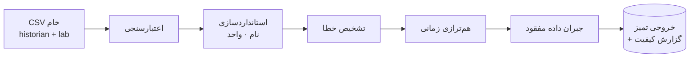

<div dir="rtl">

# 🏭 cement-pro · فاز ۱

### نیازسنجی، امکان‌سنجی و نمونهٔ آزمایشگاهی پیش‌پردازش داده‌های کوره و آسیاب سیمان


**تیم رهیاب داده** · مسئول: علیرضا طاهری فخر

</div>

> [!WARNING]
> **صادقانه:** هنوز هیچ داده‌ی واقعی کارخانه در دسترس نیست. همهٔ نتایج عددی این ریپو روی **داده‌ی مصنوعی با خطای تزریق‌شده و ground truth** به‌دست آمده است و فقط درستی مکانیزم خط‌لوله را نشان می‌دهد. عملکرد روی کارخانهٔ واقعی **UNVERIFIED** است.

## این پروژه چه می‌کند؟

خطوط کوره و آسیاب سیمان از DCS، SCADA و آزمایشگاه داده‌ی ناهمگن تولید می‌کنند: واحد و نام متفاوت، منطقهٔ زمانی متفاوت، قطعی، پرش، سنسور گیرکرده. این ریپو یک **خط‌لولهٔ پیش‌پردازش** است که داده‌ی خام را به یک جدول تمیز، هم‌تراز و **قابل‌ردیابی** تبدیل می‌کند، به‌همراه گزارش کیفیت.



## نتایج کلیدی (داده‌ی مصنوعی، ۷ روز، seed = ۴۲)

| سنجه | نتیجه |
|---|---|
| تشخیص gap / flat-line | recall = ۱٫۰ ، precision = ۱٫۰ |
| تشخیص spike | recall = ۱٫۰ ، precision ≈ ۰٫۹۵ |
| جبران gap متوسط (۶–۶۰ دقیقه) | ≈ ۱۰٪ بهتر از خطی، ≈ ۳۷٪ بهتر از نگه‌داشتن مقدار قبلی |
| gap بلند (> ۶۰ دقیقه) | **عمداً پر نمی‌شود** |
| هم‌ترازی آزمایشگاه با منطقهٔ زمانی | ۱۰۰٪ درست؛ بدون آن ۰٪ |

جزئیات و محدودیت‌ها: [گزارش ارزیابی](docs/phase1/06-lab-prototype-evaluation.md)

## مستندات فاز ۱

مطابق خروجی‌های پروپوزال:

| # | سند | وضعیت |
|---|---|---|
| ۰۱ | [نیازمندی‌ها و فرایندها](docs/phase1/01-requirements.md) | ✅ (تأیید کاربر: UNVERIFIED) |
| ۰۲ | [مطالعهٔ کارهای پیشین](docs/phase1/02-prior-art.md) | 🟡 پیش‌نویس، منابع باید راستی‌آزمایی شوند |
| ۰۳ | [پارامترهای عملکردی و غیرعملکردی](docs/phase1/03-parameters.md) | ✅ |
| ۰۴ | [منابع داده و کیفیت](docs/phase1/04-data-sources-quality.md) | ✅ (داده‌ی واقعی: UNVERIFIED) |
| ۰۵ | [معماری مفهومی خط‌لوله](docs/phase1/05-conceptual-architecture.md) | ✅ |
| ۰۶ | [گزارش ارزیابی نمونهٔ آزمایشگاهی](docs/phase1/06-lab-prototype-evaluation.md) | ✅ (مصنوعی) |
| ۰۷ | [گزارش امکان‌سنجی نهایی](docs/phase1/07-feasibility-report.md) | ✅ |

## اجرا

```bash
python -m venv .venv && source .venv/bin/activate
pip install -r requirements.txt && pip install -e .

pytest                                   # ۱۴ تست
python -m cementpro evaluate             # داده‌ی مصنوعی + ارزیابی + نمودار + گزارش ۰۶
python -m cementpro generate --days 7    # فقط ساخت داده‌ی خام نمونه
python -m cementpro run --signals data/synthetic/signals_raw.csv \
                        --lab data/synthetic/lab_raw.csv --out reports
```

برای داده‌ی واقعی: فقط [`config/tags.yaml`](config/tags.yaml) را ویرایش کنید (تگ، واحد، بازهٔ فیزیکی، منطقهٔ زمانی).

## ساختار

```
cement-pro/
├── config/tags.yaml          رجیستری تگ‌ها (نام، واحد، بازه، منطقهٔ زمانی)
├── src/cementpro/            خط‌لوله (ingest → standardize → quality → align → impute)
├── tests/                    تست‌های واحد و انتها‌به‌انتها
├── data/synthetic/           داده‌ی خام مصنوعی با خطای تزریق‌شده
├── reports/                  متریک‌ها، گزارش کیفیت، نمونهٔ خروجی
└── docs/phase1/              مستندات فارسی فاز ۱
```

## خارج از دامنهٔ فاز ۱

مدل‌های پیش‌بینی، توصیهٔ ست‌پوینت، API، داشبورد و استقرار. طبق پروپوزال این‌ها فاز ۲ و ۳ هستند.
