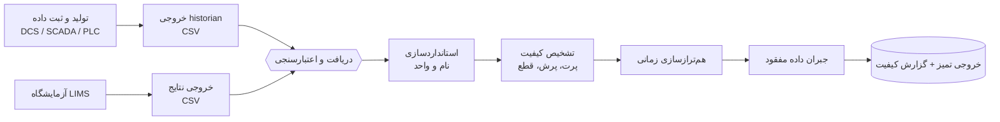

# ۰۱ · سند نیازمندی‌ها و فرایندها

> [!IMPORTANT]
> **وضعیت تأیید: UNVERIFIED.** این نیازمندی‌ها از متن پروپوزال فاز ۱ و دانش عمومی فرایند کورهٔ سیمان استخراج شده‌اند. هنوز جلسهٔ رسمی با نمایندگان فنی کارخانه (طبق گام ۱ روش فنی پروپوزال) برگزار نشده است. قبل از شروع فاز ۲ باید هر ردیف با کاربر نهایی تأیید شود.

## ۱. مسئله

خطوط کوره و آسیاب کارخانهٔ سیمان داده‌های متعددی از **DCS، SCADA، PLC، حسگرها و آزمایشگاه (LIMS)** تولید می‌کنند. این داده‌ها از نظر قالب، نرخ ثبت، کیفیت، میزان مفقودی و تأخیر زمانی یکسان نیستند. بدون یک لایهٔ پیش‌پردازش استاندارد، هر مدل یا ابزار تحلیلی روی داده‌ی ناسازگار ساخته می‌شود و خروجی غیرقابل‌استفاده یا گمراه‌کننده می‌دهد.

**هدف فاز ۱:** نیازسنجی، امکان‌سنجی و ساخت یک **نمونهٔ آزمایشگاهی** از نرم‌افزار پیش‌پردازش، پاک‌سازی و خطوله‌ی داده. فاز ۱ محصول نهایی یا بهره‌برداری عملیاتی نیست.

## ۲. ذی‌نفعان

| نقش | نیاز اصلی | وضعیت تأیید |
|---|---|---|
| مهندس فرایند / کنترل | دادهٔ هم‌تراز و قابل‌اعتماد برای تحلیل و مدل‌سازی | UNVERIFIED |
| آزمایشگاه کنترل کیفیت | اتصال نتایج آزمایشگاه به وضعیت فرایند در لحظهٔ نمونه‌برداری | UNVERIFIED |
| واحد IT / اتوماسیون | ورود داده بدون اختلال در شبکهٔ کنترل (فقط خواندن) | UNVERIFIED |
| تیم توسعه (رهیاب داده) | قرارداد روشن ورودی/خروجی و گزارش کیفیت | تأیید داخلی |

## ۳. فرایندهای هدف

## ۴. نیازمندی‌های کاربر (User Requirements)

| شناسه | نیاز | اولویت | نمونهٔ آزمایشگاهی |
|---|---|---|---|
| UR-01 | ورود داده از خروجی CSV بدون وابستگی به اتصال زندهٔ DCS | بالا | ✅ |
| UR-02 | رد کردن ردیف‌های معیوب **با ثبت دلیل**، نه حذف بی‌صدا | بالا | ✅ |
| UR-03 | یکسان‌سازی نام تگ‌ها و واحدها از منابع مختلف | بالا | ✅ |
| UR-04 | شناسایی داده‌ی پرت، پرش ناگهانی، سنسور گیرکرده (flat-line) | بالا | ✅ |
| UR-05 | شناسایی قطعی‌ها و داده‌ی مفقود و گزارش کمی آن | بالا | ✅ |
| UR-06 | هم‌ترازی زمانی چند تگ با نرخ نمونه‌برداری متفاوت | بالا | ✅ |
| UR-07 | تطبیق نمونه‌های آزمایشگاه با وضعیت فرایند (با درنظرگرفتن منطقهٔ زمانی) | بالا | ✅ |
| UR-08 | جبران داده‌ی مفقود **فقط** تا حدی که قابل‌دفاع است؛ برچسب‌گذاری نقاط جبران‌شده | بالا | ✅ |
| UR-09 | گزارش کیفیت داده به‌ازای هر تگ | متوسط | ✅ |
| UR-10 | اتصال مستقیم OPC-UA / historian | پایین (فاز ۲) | ⬜ خارج از دامنه |
| UR-11 | رابط کاربری و پیشنهاد ست‌پوینت | پایین (فاز ۳) | ⬜ خارج از دامنه |

## ۵. نیازمندی‌های عملکردی (Functional)

| شناسه | شرح | معیار پذیرش | ماژول |
|---|---|---|---|
| FR-01 | بارگذاری CSV بلند (`timestamp, tag_name, value`) و آزمایشگاه (`timestamp, parameter, value, sample_id`) | ستون ناقص ⇒ خطای واضح | `ingest.py` |
| FR-02 | ردیف با زمان یا مقدار نامعتبر به جدول `rejected` برود با ستون `reason` | تعداد رد‌شده‌ها = تعداد خطاهای تزریق‌شده | `ingest.py` |
| FR-03 | زمان بدون منطقه با منطقهٔ منبع تفسیر و به UTC تبدیل شود | نمونهٔ ۱۲:۰۰ تهران ⇒ ۰۸:۳۰ UTC | `ingest.py` |
| FR-04 | نام مستعار تگ به نام استاندارد نگاشت شود؛ تگ ثبت‌نشده جدا شود نه استفاده | تگ ناشناس هرگز وارد خروجی نشود | `registry.py` |
| FR-05 | تبدیل واحد (°F→°C، kg/s→t/h) طبق رجیستری | خطای میانه ≈ ۰ بعد از تبدیل | `standardize.py` |
| FR-06 | مقدار خارج از بازهٔ فیزیکی علامت‌گذاری و حذف شود | مقدار ۹۹۹۹۹ ⇒ `out_of_range` | `standardize.py` |
| FR-07 | تشخیص spike با فیلتر Hampel | recall ≥ ۰٫۹ روی داده‌ی برچسب‌دار | `quality.py` |
| FR-08 | تشخیص flat-line (سنسور گیرکرده) | recall ≥ ۰٫۹۵ | `quality.py` |
| FR-09 | تشخیص و اندازه‌گیری gap | همهٔ gapهای تزریق‌شده یافت شود | `quality.py` |
| FR-10 | هم‌گام‌سازی تگ‌های ۱ و ۵ دقیقه‌ای روی یک شبکهٔ زمانی بدون جعل داده بین نمونه‌های مفقود | هیچ مقداری داخل gap بومی ساخته نشود | `align.py` |
| FR-11 | جبران gap به‌صورت سیاست‌محور (کوتاه/متوسط/بلند) | gap بلند پر نشود | `impute.py` |
| FR-12 | هر نقطهٔ جبران‌شده و هر نقطهٔ غیرقابل‌جبران برچسب بخورد | ماسک `imputed` و `unrecoverable` در خروجی | `pipeline.py` |
| FR-13 | گزارش کیفیت به‌ازای هر تگ | CSV با completeness، gap، spike، flat-line، نویز | `quality.py` |
| FR-14 | اتصال نمونهٔ آزمایشگاه به نزدیک‌ترین ردیف زمانی با تحمل مشخص | نرخ هم‌ترازی صحیح روی داده‌ی برچسب‌دار | `align.py` |

## ۶. فرضیات و پرسش‌های باز

- ساختار واقعی خروجی historian کارخانه (long یا wide؟ فاصلهٔ نمونه‌برداری؟) **UNKNOWN**.
- تأخیر واقعی بین نمونه‌برداری و ثبت زمان در LIMS **UNKNOWN**؛ در نمونه ۰ فرض شده و قابل‌پیکربندی است (`lab_lag_minutes`).
- فهرست تگ‌های واقعی و واحدهای آن‌ها **UNKNOWN**؛ رجیستری فعلی نمونه‌ی نمادین است.
- آیا خروجی CSV دوره‌ای است یا باید به‌صورت stream خوانده شود؟ **UNKNOWN**.
