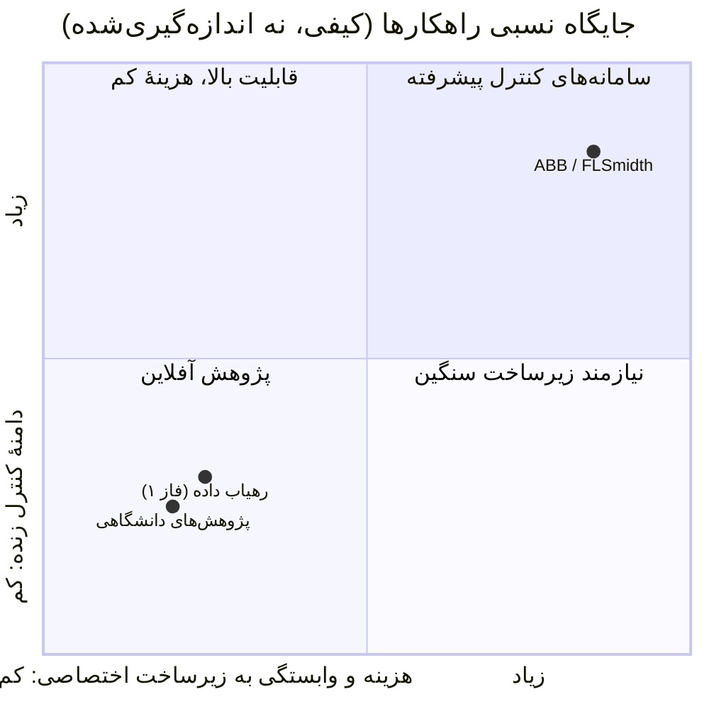

# ۰۲ · مطالعهٔ کارهای پیشین و محصولات مشابه

> [!WARNING]
> **سطح اطمینان: LOW CONFIDENCE.** این بخش بر پایهٔ جدول «سوابق و محصولات مشابه» پروپوزال و دانش عمومی نوشته شده و مستندات رسمی فروشندگان در این نسخه **بازبینی نشده‌اند**. جزئیات فنی محصولات تجاری عمداً کم‌ریز است تا ادعای نادرست ثبت نشود. فهرست منابع (مقاله‌ها و مستندات) در گام بعدی گردآوری و راستی‌آزمایی می‌شود؛ تا آن زمان هیچ مقاله‌ای با نام و سال ذکر نشده است.

## ۱. چشم‌انداز

| ردیف | محصول / پژوهش | نوع | رویکرد (طبق پروپوزال) | وضعیت منبع |
|---|---|---|---|---|
| ۱ | ABB Ability Expert Optimizer | سامانهٔ تجاری | کنترل پیشرفته و بهینه‌سازی کورهٔ سیمان | UNVERIFIED |
| ۲ | FLSmidth ECS/ProcessExpert | پلتفرم تجاری | بهینه‌سازی هوشمند خطوط سیمان | UNVERIFIED |
| ۳ | مدل‌سازی و پیش‌بینی KPI کوره با یادگیری ماشین | مقاله / پایان‌نامه | مدل‌های داده‌محور روی داده‌ی تاریخی | UNVERIFIED |

## ۲. تمایز این پروژه (طبق پروپوزال)

> [!NOTE]
> موقعیت‌های بالا برداشت کیفی تیم از پروپوزال است و بر داده‌ی بازار تکیه ندارد.

| بُعد | سامانه‌های تجاری بزرگ | پژوهش‌های دانشگاهی | این پروژه |
|---|---|---|---|
| هزینهٔ استقرار | سنگین، وابسته به بستر اختصاصی | کم | سبک، Python استاندارد |
| وابستگی به سخت‌افزار فروشنده | بالا | ندارد | ندارد |
| داده‌ی چندمنبعی صنعتی | بله | معمولاً دادهٔ آفلاین محدود | **هدف اصلی فاز ۱** |
| قابلیت انعطاف برای کارخانهٔ هگمتان | محدود | — | طراحی بومی‌پذیر با رجیستری تگ |

## ۳. درس‌های قابل‌استفاده در طراحی

1. هر راهکار کنترل یا پیش‌بینی به **داده‌ی تمیز و هم‌تراز** وابسته است؛ بنابراین پیش‌پردازش یک جزء حیاتی است نه جزئیات جانبی.
2. در داده‌ی آزمایشگاه، فاصلهٔ نمونه‌برداری زیاد و تأخیر ثبت، اتصال به داده‌ی فرایند را دشوار می‌کند (که این پروژه صریحاً برایش ماژول `align_lab` دارد).
3. خروجی بدون برچسب «اصلی/جبران‌شده» برای مدل‌سازی پایین‌دست خطرناک است (طراحی ماسک‌ها).

## ۴. کارهای باقی‌مانده برای تکمیل این گزارش

- [ ] خواندن مستندات عمومی ABB و FLSmidth و ثبت لینک و تاریخ دسترسی
- [ ] جست‌وجوی سیستماتیک مقاله دربارهٔ soft sensor برای free lime و پیش‌بینی KPI کوره
- [ ] مرور روش‌های جبران داده‌ی مفقود در سری زمانی صنعتی
- [ ] جدول مقایسهٔ نهایی با ارجاع
