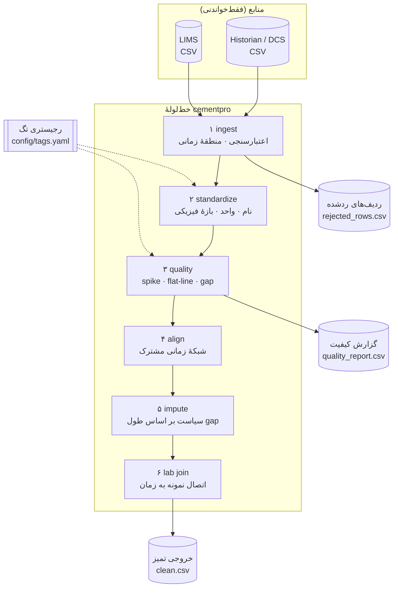
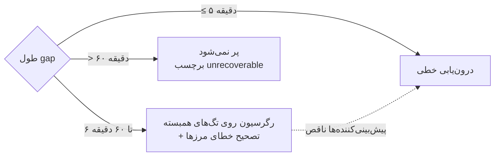

# ۰۵ · معماری مفهومی خط‌لوله‌ی داده

## ۱. نمای کلی

## ۲. ساختار داده‌ی ورودی

**signals** (CSV بلند)

| ستون | نوع | توضیح |
|---|---|---|
| `timestamp` | رشته/زمان | با یا بدون منطقه؛ بدون منطقه ⇒ منطقهٔ منبع |
| `tag_name` | رشته | نام خام تگ یا نام مستعار |
| `value` | عدد | مقدار خام |

**lab** (CSV بلند)

| ستون | نوع | توضیح |
|---|---|---|
| `timestamp` | رشته | معمولاً زمان محلی بدون منطقه |
| `parameter` | رشته | مثل `FREE_LIME` |
| `value` | عدد | — |
| `sample_id` | رشته | اختیاری |

## ۳. ساختار داده‌ی خروجی

| خروجی | ساختار | کاربرد |
|---|---|---|
| `clean` | wide، ایندکس زمانی UTC، یک ستون برای هر تگ، ستون‌های `LAB_*` | ورودی مدل‌سازی (فاز ۲/۳) |
| `imputed` | bool، هم‌شکل با `clean` | بدانیم کدام مقدار اصلی نیست |
| `unrecoverable` | bool | نقاط پرنشده |
| `cause` | به‌ازای هر تگ: `missing / spike / flatline / out_of_range` | بازرسی |
| `quality` | یک ردیف برای هر تگ | گزارش کیفیت |
| `rejected` | ردیف‌های ورودی رد‌شده + `reason` | ردیابی |

## ۴. تصمیم‌های طراحی کلیدی

| تصمیم | دلیل |
|---|---|
| gap بلند پر **نمی‌شود** | دادهٔ ساختگی روی قطعی طولانی مدل پایین‌دست را سوگیر می‌کند |
| رد کردن ردیف همراه با دلیل | ردیابی‌پذیری و اعتماد مهندس فرایند |
| درون‌یابی تگ کند فقط بین دو نمونهٔ **واقعی** | جلوگیری از جعل داده در هم‌ترازی |
| رجیستری YAML به‌جای کد | افزودن تگ بدون برنامه‌نویسی |
| زمان همیشه UTC داخل خط‌لوله | حذف ابهام منطقهٔ زمانی |
| ماسک `imputed` در خروجی | مدل‌ساز بتواند نقاط جبران‌شده را وزن‌دهی یا حذف کند |
| فقط فایل، بدون اتصال زنده | ایمنی شبکهٔ کنترل؛ اتصال OPC-UA در فاز ۲ |

## ۵. سیاست جبران داده‌ی مفقود

## ۶. نقشهٔ ماژول‌ها

| ماژول | مسئولیت |
|---|---|
| [`registry.py`](../../src/cementpro/registry.py) | بارگذاری رجیستری تگ |
| [`ingest.py`](../../src/cementpro/ingest.py) | بارگذاری، اعتبارسنجی، رد با دلیل |
| [`standardize.py`](../../src/cementpro/standardize.py) | نام، واحد، بازهٔ فیزیکی |
| [`quality.py`](../../src/cementpro/quality.py) | تشخیص spike / flat-line / gap و معیارهای کیفیت |
| [`align.py`](../../src/cementpro/align.py) | شبکهٔ زمانی و اتصال آزمایشگاه |
| [`impute.py`](../../src/cementpro/impute.py) | جبران داده مفقود |
| [`pipeline.py`](../../src/cementpro/pipeline.py) | ارکستراسیون |
| [`synth.py`](../../src/cementpro/synth.py) | داده‌ی مصنوعی با خطای برچسب‌دار |
| [`evaluation.py`](../../src/cementpro/evaluation.py) | امتیازدهی در برابر ground truth |
| [`report.py`](../../src/cementpro/report.py) | نمودار و متریک |
