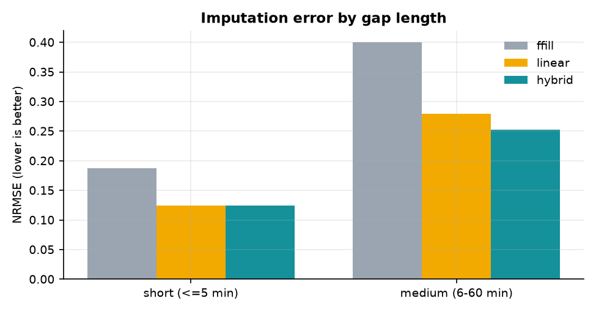
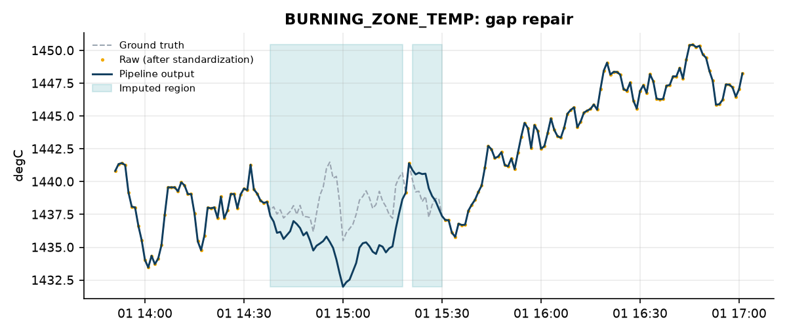
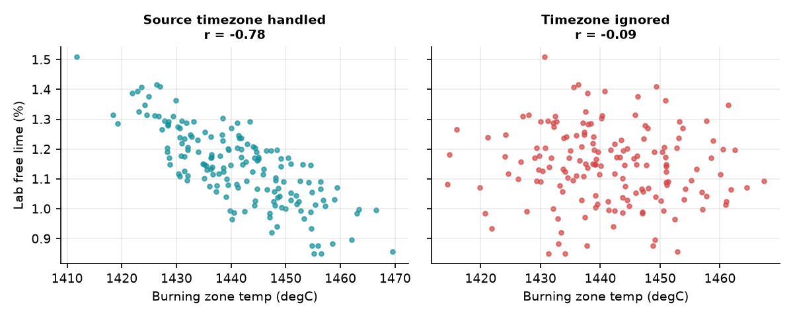
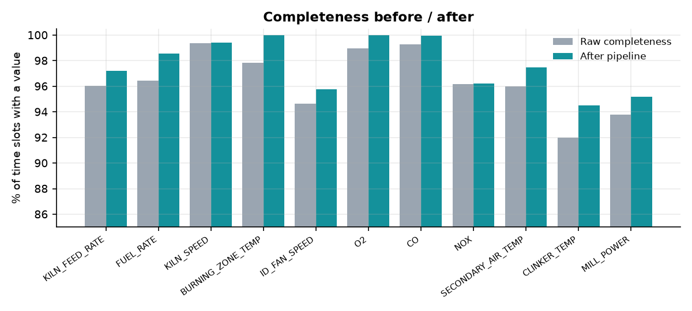

# ۰۶ · گزارش ارزیابی نمونهٔ آزمایشگاهی

> [!CAUTION]
> **این نتایج روی داده‌ی مصنوعی هستند.** خطاها را خودمان تزریق کرده‌ایم، پس عدد بالا نشان می‌دهد **خط‌لوله درست کار می‌کند**، نه اینکه روی کارخانهٔ واقعی همین دقت را دارد. عملکرد روی داده‌ی واقعی: **UNVERIFIED**.
> این فایل خودکار از `reports/metrics.json` ساخته می‌شود؛ برای بازتولید: `python -m cementpro evaluate`.

## ۱. آزمایش چگونه انجام شد

| مورد | مقدار |
|---|---|
| مدت داده | ۷ روز، seed = ۴۲ |
| ردیف خام سیگنال | ۹۱۳۸۳ |
| خطاهای تزریق‌شده | gap (کوتاه/متوسط/بلند)، spike، flat-line، مقدار محال، ردیف تکراری، ردیف نامعتبر، تگ ناشناس، واحد متفاوت (°F و kg/s)، زمان آزمایشگاه به وقت تهران |
| ردیف رد‌شده در ورود | ۳ (همه با دلیل) |
| ردیف تگ ناشناس (جداشده) | ۵۰ |
| ردیف تکراری حذف‌شده | ۱۸۲ |

> [!NOTE]
> پارامتر آستانهٔ spike روی seedهای ۱ تا ۳ تنظیم شد و این گزارش روی seed = ۴۲ (دیده‌نشده) است.

## ۲. تشخیص خطا

| نوع خطا | TP | FP | FN | Precision | Recall |
|---|---|---|---|---|---|
| Spike (پرش) | ۶۰ | ۳ | ۰ | ۰٫۹۵۲ | ۱٫۰۰۰ |
| Flat-line (سنسور گیرکرده) | ۵۱۴ | ۰ | ۰ | ۱٫۰۰۰ | ۱٫۰۰۰ |
| Gap (مفقود) | ۳۶۰۴ | ۰ | ۰ | ۱٫۰۰۰ | ۱٫۰۰۰ |

- همهٔ gapها و نمونه‌های flat-line یافته شدند و هیچ هشدار کاذبی برای آن‌ها نبود.
- برای spike، تعداد هشدار کاذب ۳ است (چرخش‌های طبیعی سیگنال). این یک مصالحه‌ی آستانه است: آستانهٔ پایین‌تر هشدار کاذب بیشتری می‌دهد.

## ۳. جبران داده‌ی مفقود

خطای نرمال‌شده (NRMSE = RMSE ÷ انحراف معیار حقیقت؛ کمتر بهتر) روی نمونه‌هایی که نامعتبر بودند:

| طول gap | نمونهٔ نامعتبر | درصد پرشده | NRMSE |
|---|---|---|---|
| کوتاه (≤ ۵ دقیقه) | ۱۶۳ | ۱۰۰٫۰٪ | ۰٫۱۲۴ |
| متوسط (۶–۶۰ دقیقه) | ۱۷۴۴ | ۱۰۰٫۰٪ | ۰٫۲۵۲ |
| بلند (> ۶۰ دقیقه) | ۲۲۷۹ | ۰٫۰٪ | پر نشد (عمدی) |

| روش | NRMSE کوتاه | NRMSE متوسط |
|---|---|---|
| ffill | ۰٫۱۸۷ | ۰٫۴۰۰ |
| linear | ۰٫۱۲۴ | ۰٫۲۷۹ |
| hybrid | ۰٫۱۲۴ | ۰٫۲۵۲ |

- روش ترکیبی (`hybrid`) روی gap متوسط حدود **۱۰٪** بهتر از درون‌یابی خطی و حدود **۳۷٪** بهتر از نگه‌داشتن آخرین مقدار است.
- برتری روش ترکیبی **متوسط** است و بخشی از آن به این برمی‌گردد که تگ‌های شبیه‌ساز عمداً همبسته ساخته شده‌اند. روی داده‌ی واقعی ممکن است کمتر باشد.
- روی gap بلند عمداً هیچ داده‌ای ساخته نشد.

## ۴. هم‌ترازی آزمایشگاه

| سناریو | نمونه در خروجی | درست هم‌تراز | همبستگی (free lime با دمای ناحیهٔ پخت) |
|---|---|---|---|
| منطقهٔ زمانی اعمال شد | ۲۳۹ | ۱۰۰٫۰٪ | -۰٫۷۸ |
| منطقهٔ زمانی نادیده گرفته شد | ۲۳۶ | ۰٫۰٪ | -۰٫۰۹ |

> [!NOTE]
> رابطهٔ منفی free lime و دما را خودمان در شبیه‌ساز گذاشته‌ایم. هدف این آزمایش فقط نشان دادن این است که **اشتباه در منطقهٔ زمانی** این رابطه را کاملاً از بین می‌برد و خط‌لوله آن را درست می‌کند.

## ۵. استانداردسازی واحد

سه تگ با نام و واحد متفاوت وارد شدند (`BZT_F` به °F، `KLN_FUEL_KGS` به kg/s، `KLN_FEED_TPH`). بعد از استانداردسازی، میانهٔ خطای مطلق نسبت به حقیقت برابر ۰٫۰۰۰۰ است (خطای عددی ممیز شناور).

## ۶. کامل‌بودن داده

- سهم نمونه‌های پرنشده (gap بلند): **۲٫۳۴٪** از کل سلول‌های فرایندی.
- انحراف ساختار همبستگی بین تگ‌ها نسبت به حقیقت (میانگین قدر مطلق تفاوت): **۰٫۰۱۴**؛ یعنی ترمیم، ارتباط بین متغیرها را به‌طور محسوس خراب نکرده است.

## ۷. گزارش کیفیت به‌ازای هر تگ

| تگ | واحد | کامل‌بودن ٪ | تعداد gap | بزرگ‌ترین gap (دقیقه) | spike | نمونهٔ flat-line | تکراری | خارج از بازه |
|---|---|---|---|---|---|---|---|---|
| KILN_FEED_RATE | t/h | ۹۶٫۰۲ | ۱۰ | ۲۸۱ | ۶ | ۵۰ | ۱۵ | ۱ |
| FUEL_RATE | t/h | ۹۶٫۴۵ | ۱۱ | ۱۴۷ | ۷ | ۵۵ | ۱۹ | ۰ |
| KILN_SPEED | rpm | ۹۹٫۳۶ | ۸ | ۳۹ | ۸ | ۱۵۵ | ۱۹ | ۰ |
| BURNING_ZONE_TEMP | degC | ۹۷٫۸۳ | ۱۸ | ۵۰ | ۸ | ۴۳ | ۲۷ | ۲ |
| ID_FAN_SPEED | % | ۹۴٫۶۶ | ۱۰ | ۳۵۸ | ۴ | ۶۷ | ۱۶ | ۰ |
| O2 | % | ۹۸٫۹۷ | ۱۶ | ۳۵ | ۴ | ۵۸ | ۱۹ | ۱ |
| CO | ppm | ۹۹٫۲۶ | ۸ | ۲۰ | ۸ | ۱۲ | ۷ | ۰ |
| NOX | mg/Nm3 | ۹۶٫۱۸ | ۱۰ | ۱۷۰ | ۵ | ۲۳ | ۵ | ۰ |
| SECONDARY_AIR_TEMP | degC | ۹۶٫۰۱ | ۱۳ | ۱۶۷ | ۴ | ۵۱ | ۱۹ | ۱ |
| CLINKER_TEMP | degC | ۹۲٫۰۰ | ۱۴ | ۳۰۷ | ۲ | ۰ | ۱۴ | ۰ |
| MILL_POWER | kW | ۹۳٫۸۱ | ۱۳ | ۳۳۷ | ۷ | ۰ | ۲۲ | ۰ |

## ۸. محدودیت‌ها (صادقانه)

1. **داده‌ی مصنوعی:** ساختار نویز، خطا و همبستگی را ما ساخته‌ایم؛ داده‌ی واقعی نویزی‌تر و ناهمگن‌تر است.
2. **فقط ۱۱ تگ و ۲ پارامتر آزمایشگاهی:** کارخانه‌ی واقعی صدها تگ دارد.
3. **تأخیر آزمایشگاه صفر فرض شد.** اگر تأخیر واقعی نامعلوم باشد، `lab_lag_minutes` باید کالیبره شود.
4. **آستانه‌ها (spike، flat-line) برای فرایند واقعی باید کالیبره شوند.**
5. **عملکرد زمانی روی سخت‌افزار کارخانه** اندازه‌گیری نشده است.
6. روش جبران متوسط به **وجود تگ‌های همبسته‌ی سالم** در همان لحظه وابسته است؛ در قطعی همزمان چند تگ به درون‌یابی خطی برمی‌گردد.
