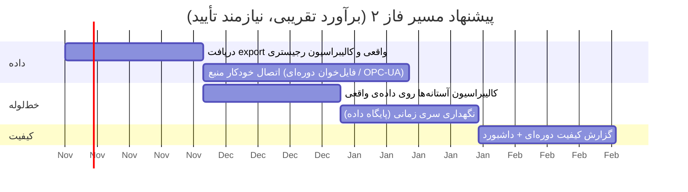

# ۰۷ · گزارش امکان‌سنجی نهایی

## ۱. نتیجه در یک نگاه

| محور | حکم | اعتماد | پشتوانه |
|---|---|---|---|
| **فنی (مکانیزم خط‌لوله)** | ✅ امکان‌پذیر | بالا | [۰۶](06-lab-prototype-evaluation.md): تشخیص و ترمیم روی داده‌ی برچسب‌دار، ۱۴ تست خودکار |
| **فنی (روی داده‌ی واقعی کارخانه)** | 🟡 مشروط | **UNVERIFIED** | داده‌ی واقعی دریافت نشده |
| **زیرساختی** | 🟢 کم‌ریسک | متوسط | فقط Python و پردازش آفلاین؛ نیاز به GPU و اینترنت ندارد |
| **سازمانی / دسترسی به داده** | 🔴 بزرگ‌ترین ریسک | — | به همکاری کارخانه وابسته است |
| **اقتصادی** | UNKNOWN | — | تحلیل هزینه‌فایده نیازمند داده و پایلوت واقعی است |

> [!IMPORTANT]
> **توصیه: ادامه به فاز ۲، به‌شرط گرفتن حداقل یک export واقعی (۱ تا ۴ هفته، حتی ناقص) در ۴ هفتهٔ اول فاز ۲.** اگر داده‌ی واقعی نرسد، نتایج فاز ۱ فقط یک اثبات‌مفهوم باقی می‌ماند.

## ۲. آنچه ثابت شد و آنچه ثابت نشد

| ادعا | وضعیت |
|---|---|
| خط‌لوله ورود، استانداردسازی، تشخیص خطا، هم‌ترازی و جبران را انجام می‌دهد | ✅ ثابت‌شده روی داده‌ی مصنوعی |
| gap بلند را جعل نمی‌کند | ✅ |
| منطقهٔ زمانی و واحد را درست یکسان می‌کند | ✅ |
| روی داده‌ی واقعی با همین دقت کار می‌کند | ⬜ **ثابت نشده** |
| آستانه‌ها برای فرایند واقعی مناسب‌اند | ⬜ نیاز به کالیبراسیون |
| بهبود واقعی در کیفیت مدل پایین‌دست | ⬜ در دامنهٔ فاز ۲ |

## ۳. ریسک‌ها (بازبینی ریسک‌های پروپوزال)

| # | نوع | ریسک | روش کاهش | وضعیت فعلی |
|---|---|---|---|---|
| ۱ | فنی | اطلاعات ناقص از فرایندها و نیازهای کاربر | جلسات منظم با نمایندهٔ کاربر، ثبت فرضیات | 🔴 جلسهٔ رسمی انجام نشده؛ فرضیات در [۰۱](01-requirements.md) ثبت شد |
| ۲ | فنی | داده‌ی مفقود، ناقص یا پرنویز | چند روش پاک‌سازی، ثبت محدودیت | 🟢 پیاده‌سازی و ارزیابی شد (مصنوعی) |
| ۳ | زمانی | تأخیر در دریافت اسناد یا داده | فهرست داده در ابتدای پروژه، تحلیل اولیه با نمونه | 🟡 باز؛ از داده‌ی مصنوعی استفاده شد |
| ۴ | فنی | ناسازگاری زمانی داده‌های فرایندی و آزمایشگاهی | تحلیل تأخیر زمانی، اعتبارسنجی روی چند بازه | 🟢 ماژول انجام شد؛ تأخیر واقعی UNKNOWN |
| ۵ | برنامه‌ای | افزایش دامنه و ورود زودهنگام به ساخت محصول کامل | محدودکردن فاز به نمونهٔ آزمایشگاهی | 🟢 رعایت شد (ML، API، UI در این ریپو نیست) |

## ۴. نقشهٔ راه به فاز ۲

| بسته | خروجی | معیار پذیرش |
|---|---|---|
| ۱. داده‌ی واقعی | گزارش ۰۴ و ۰۶ بازتولیدشده روی داده‌ی واقعی | عدد واقعی جایگزین «UNVERIFIED» |
| ۲. کالیبراسیون | آستانه‌ها و بازهٔ فیزیکی تأییدشده با مهندس فرایند | تأیید کتبی |
| ۳. اتصال منبع | ورود خودکار دوره‌ای | اجرای ۷ روز پیاپی بدون دخالت |
| ۴. مخزن داده | ذخیره‌ی سری زمانی تمیز | بازیابی بازهٔ دلخواه |
| ۵. پایداری | لاگ، هشدار، مانیتورینگ | — |

## ۵. چه چیزی عمداً در فاز ۱ نیست

مدل‌های پیش‌بینی، پیشنهاد ست‌پوینت، API، داشبورد اپراتور، استقرار کانتینری — طبق پروپوزال این‌ها محصول فاز ۲ و ۳ هستند. نمونهٔ MVP قبلی در ریپوی جداگانهٔ `cement-kiln-copilot` است.
